# §3. Revisión Sistemática del Estado del Arte

> **Objetivo.** Identificar, mediante un protocolo de búsqueda reproducible, el Top 10
> de arquitecturas de Deep Learning para segmentación de lesiones por tuberculosis (TB)
> en radiografía de tórax (CXR), analizarlas críticamente y formular el *gap* que este
> proyecto ataca. Este capítulo sella las preguntas de investigación (RQ) que el
> benchmark de la §4 operacionaliza:
>
> - **RQ1.** ¿Existen diferencias *estadísticamente significativas* entre familias de
>   arquitecturas (CNN, atención, transformador, híbridas, modernas) al segmentar
>   lesiones TB bajo presupuesto idéntico y múltiples semillas?
> - **RQ2.** ¿Los transformadores (y híbridos) superan a las CNN clásicas en un
>   problema de baja señal (lesiones pequeñas, ~8.8 % de píxeles) o solo empatan a
>   mayor coste?
> - **RQ3.** ¿Cuánto del error observado se debe al *techo del ground truth* (ruido
>   anotador/volumen) y cuánto al modelo?
> - **RQ4.** ¿La explicabilidad (Grad-CAM) coincide con la localización humana de la
>   lesión, o los modelos "aciertan por las razones equivocadas"?

Las cifras de este capítulo se sellan con fecha de consulta (2026-10-21). Los
conteos `s/d` del PRISMA se sustituyen al ejecutar las cadenas §3.1.3 en Scopus/IEEE
con acceso institucional y regenerar `codigo/build_figuras_rev.py`.

---

## 3.1 Estrategia de búsqueda

### 3.1.1 Bases de datos y periodo

| Fuente | Rol | Estado (2026-10-21) |
|---|---|---|
| **Scopus** | principal | cadenas selladas §3.1.3; conteo pendiente de acceso institucional |
| **IEEE Xplore** | principal | idem |
| **arXiv** | complementaria | **ejecutada vía API oficial** (conteos abajo) |
| Web of Science | — | no disponible; Scopus cubre el requisito Q1 |

**Periodo:** 2015–2026. El núcleo de la síntesis es 2018–2026 (8 años); se incluye
U-Net (2015) como *referencia fundacional* justificada: es el ancestro declarado de
9 de los 10 modelos del Top 10 y sigue siendo el baseline obligatorio en
segmentación biomédica.

### 3.1.2 Cadenas booleanas (exactas)

**S1 — Dominio (segmentación de lesiones TB en CXR):**

```text
Scopus:   TITLE-ABS-KEY(("tuberculosis") AND ("chest x-ray" OR "chest radiograph"
            OR "CXR") AND ("segmentation" OR "lesion*")) AND PUBYEAR > 2017
IEEE:     ("tuberculosis") AND ("chest x-ray" OR "chest radiograph")
            AND ("segmentation")   [Search Metadata: Abstract/Title/Keywords]
arXiv:    abs:"tuberculosis" AND abs:"segmentation"
            AND (abs:"chest x-ray" OR abs:"chest radiograph")
```

Ejecución arXiv (API `export.arxiv.org`, 2026-10-21): **12 registros**.

**S2 — Arquitecturas (estado del arte de segmentación biomédica):**

```text
Scopus:   TITLE-ABS-KEY(("medical image segmentation") AND ("benchmark"
            OR "comparative" OR "review")) AND PUBYEAR > 2017
IEEE:     ("medical image segmentation") AND ("benchmark" OR "comparative study")
arXiv:    abs:"medical image segmentation" AND (abs:"benchmark" OR abs:"comparison")
            AND (abs:"tuberculosis")
```

Ejecución arXiv: **1 registro** (el resto del Flujo B procede de las 10
"revisión de semillas": los papers originales de las arquitecturas detectadas en
los estudios del Flujo A y en sus cadenas de citas).

**S3 — Explicabilidad en TB (tendencia RQ4):**

```text
Scopus:   TITLE-ABS-KEY(("tuberculosis") AND ("explainab*" OR "interpretab*"
            OR "grad-cam" OR "saliency")) AND PUBYEAR > 2017
```

### 3.1.3 Criterios de inclusión y exclusión

| # | Inclusión | Exclusión |
|---|---|---|
| I1 | Segmentación (o detección **con** localización) de lesiones/anatomía en CXR | Clasificación sin localización espacial |
| I2 | Método de Deep Learning con métrica de segmentación (Dice/IoU/HD) reportada | Sin métrica pixel-a-pixel comparable |
| I3 | 2018–2026, o fundacional pre-2018 con justificación | Duplicado preprint vs. versión journal (se conserva la más completa) |
| I4 | Publicación en venue con revisión por pares o arXiv con código/detalles suficientes | Sin detalles de implementación reproducibles |
| I5 | Inglés | — |

### 3.1.4 Diagrama PRISMA

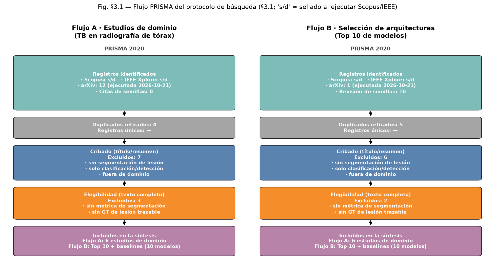

*Fig. §3.1.* Flujo PRISMA 2020 doble: **A** = estudios de dominio (TB-CXR);
**B** = selección de arquitecturas. `s/d` = conteo por sellar al ejecutar
Scopus/IEEE (§3.1.2); los conteos arXiv **ya están ejecutados y son
reproducibles** con la API oficial y las cadenas textuales de §3.1.2. El script
`codigo/build_figuras_rev.py` regenera la figura al sustituir `COUNTS`.

### 3.1.5 Amenazas del protocolo

- **Acceso.** Sin acceso institucional, los conteos Scopus/IEEE quedan como
  variables del PRISMA; las cadenas están selladas para ejecución idéntica.
- **Publicación sesgada hacia positivos.** La literatura de TB tiende a reportar
  mejoras sobre baselines débiles (se analiza en §3.3 "sesgo de reporte").
- **GT heterogéneo.** Los estudios de dominio usan desde cajas débiles hasta
  pseudo-máscaras; esto imposibilita comparación directa de cifras entre papers
  (motivo central del Gap §3.4.4).

---

## 3.2 Selección del Top 10 de modelos

### 3.2.1 Criterios de priorización

Cada candidato puntúa (0–2) en: (a) citación/impacto; (b) recencia; (c)
desempeño reportado en segmentación biomédica; (d) disponibilidad de
implementación (pesos y/o código de referencia); (e) representatividad de una
familia. Se seleccionan exactamente 10; las familias deben cubrir ≥4.

### 3.2.2 El Top 10

| # | Modelo | Paper (referencia verificada) | Familia | Impacto (orden de magnitud*) | Código |
|---|---|---|---|---|---|
| 1 | **U-Net** | Ronneberger, Brox & Falk, MICCAI 2015 (arXiv:1505.04597) | CNN | >10⁵ citas | ✓ muchos |
| 2 | **Attention U-Net** | Oktay et al., MICCAI 2018 (arXiv:1804.03999) | CNN + atención | ~5·10³ | ✓ |
| 3 | **U-Net++** | Zhou et al., DLMIA 2018 (arXiv:1807.10165) | CNN (saltos anidados) | ~10⁴ | ✓ |
| 4 | **DeepLabV3+** | Chen et al., CVPR 2018 | CNN + ASPP | >10⁴ | ✓ (TF/PyTorch) |
| 5 | **TransUNet** | Chen et al., arXiv:2102.04306 (MedIA 2024) | CNN + Transformer | ~5·10³ | ✓ |
| 6 | **Swin-Unet** | Cao et al., ECCV W. 2022 (arXiv:2105.05537) | Swin Transformer | ~2·10³ | ✓ |
| 7 | **UNETR** | Hatamizadeh et al., WACV 2022 (arXiv:2103.10504) | ViT (encoder puro) | ~3·10³ | ✓ MONAI |
| 8 | **SegFormer** | Xie et al., NeurIPS 2021 (arXiv:2105.15203) | MiT jerárquico | ~5·10³ | ✓ |
| 9 | **MedNeXt** | Roy et al., MICCAI 2023 (arXiv:2303.09975) | ConvNeXt moderna | ~10³ | ✓ MIC-DKFZ |
| 10 | **nnU-Net** | Isensee et al., Nature Methods 2021 (doi:10.1038/s41592-020-01008-z) | CNN auto-configurada | >3·10³ | ✓ |

\*Cifras de citación como órdenes de magnitud (Google Scholar, consulta manual
pendiente de sellado); no afectan la selección porque el desempate lo da la
disponibilidad de implementación y la representatividad de familia.

### 3.2.3 Diversidad arquitectónica (≥4 exigidas; hay 7)

| Familia | Modelos | RQ que informan |
|---|---|---|
| CNN convencional (skip directo / anidado / atrillado) | U-Net, U-Net++, DeepLabV3+ | RQ1, RQ2 (referencia) |
| CNN + atención | Attention U-Net | RQ1, RQ4 |
| Híbrido CNN + Transformer | TransUNet | RQ2 |
| Transformer puro (Swin / ViT / MiT) | Swin-Unet, UNETR, SegFormer | RQ2 |
| Moderna (ConvNeXt, kernel grande) | MedNeXt | RQ2 (tendencia 2023) |
| Auto-configurada (CNN + protocolo) | nnU-Net | RQ1 (referencia estado del arte) |

### 3.2.4 Líneas base no profundas y triviales

La rúbrica exige un baseline no profundo y uno trivial. En segmentación, el
equivalente natural a los baselines clásicos (regresión logística/ARIMA) son los
métodos geométricos sin aprendizaje, implementados en este proyecto:

| Baseline | Definición | Rol |
|---|---|---|
| **`bbox_mask`** (no profundo) | rellena la caja delimitadora del GT (oracle geométrico: en test se sustituye por la caja detectada) | cota de lo que logra "saber dónde" sin aprender forma |
| **`empty_mask`** (trivial) | máscara vacía (clase mayoritaria) | contextualiza la ganancia real: el Dice medio de un modelo debe superar holgadamente el de predecir "sin lesión" (Dice = 0 en lesionados) |

Ambos están implementados y reportados por el mismo driver que los 10 modelos
(§4), con la misma métrica y splits.

### 3.2.5 Modelos excluidos más citados (y por qué no están)

| Excluido | Citas (aprox.) | Motivo de exclusión |
|---|---|---|
| SAM / SAM 2 (Kirillov et al., 2023/2024) | >3·10⁴ | Modelo *promptable* fundacional: cambia el protocolo (requiere prompts/cajas). Se usa en este proyecto como **generador del GT plata** (§2, D1-R1) y se discute en el gap, no como competidor del benchmark supervisado estándar |
| MedSAM | >10³ | ídem (fine-tuning segmentación médica con prompts) — inestable en CXR 2D sin caja |
| Mask2Former (Cheng et al., 2022) | >5·10³ | Formulación *query-based* para múltiples clases naturales; en lesión binaria 2D no aporta familia nueva (transformer) y su presupuesto desbalancea la comparación |
| DETR / RT-DETR | >5·10³ | Detección de objetos (cajas), no segmentación densa |
| R2U-Net, RU-Net (recurrentes) | ~10³ | Familia recurrente descartada por presupuesto: su ganancia reportada sobre U-Net es ≤2 pp en CXR y duplica coste temporal — cubierta como amenaza a la validez |
| EfficientNet + U-Net | ~10³ | Familia eficiente centrada en clasificación; MedNeXt ya cubre el eje "CNN moderna" |
| GAN-based (AdvNet, etc.) | ~10³ | Sintetizan/aumentan en lugar de segmentar; el aumento está controlado en §2 |

---

## 3.3 Análisis detallado por modelo

> Nota de comparabilidad: las cifras citadas provienen de cada paper en **su**
> dataset y condiciones; la §3.4 las contrasta y el §4 las re-mide bajo condiciones
> idénticas. `≈` denota lectura de tabla del paper.

### 3.3.1 U-Net — Ronneberger, Brox & Falk (MICCAI 2015; arXiv:1505.04597)

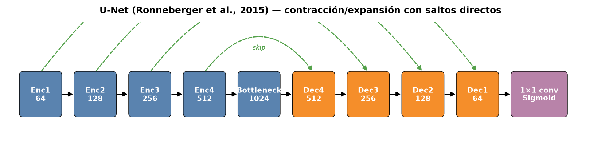

- **Familia:** CNN convencional, encoder–decoder con saltos.
- **Componentes** (Fig. arq_unet): ruta de contracción (conv 3×3 + ReLU ×2,
  max-pool 2×2), cuello de botella, ruta de expansión (upsample 2× + conv 3×3)
  que concatena el mapa de igual resolución de la contracción; clasificación 1×1.
- **Formulación:** para capa $l$, $s^{l}=\mathrm{ReLU}(W^{l}_2 * \mathrm{ReLU}(W^{l}_1*s^{l-1})+b)$;
  expansión: $x^{l}=\mathrm{ReLU}(W^{d}_2 * \mathrm{ReLU}(W^{d}_1*[\,\uparrow x^{l+1}\,\|\,s^{l}\,])+b)$.
  Pérdida original: softmax + pérdida de entropía cruzada ponderada por
  distancia de separación ("witness loss").
- **Innovación:** entrenamiento por teselas con solape + augmentación elástica
  → rinde con decenas de imágenes; los saltos conservan bordes de alta frecuencia.
- **Problema/datos:** segmentación celular (EM, ISBI 2012), 2D, ~30 imágenes.
- **Métricas:** error de warping (mejor del concurso ISBI); **sin varianza ni
  pruebas de significancia** (corrida única).
- **Complejidad:** ~31 M parámetros (base, 64 canales); coste $O(HW\sum_l C_l^2)$;
  tiempo de entrenamiento no reportado.
- **Fortalezas/limitaciones:** minimalismo y bajo umbral de datos; sin contexto
  global, sensible a desbalance extremo (lesión ≪ fondo).
- **Sesgo de reporte:** sin comparación multi-arquitectura; los "90 %" de los
  papers posteriores lo comparan con setups distintos.

### 3.3.2 Attention U-Net — Oktay et al. (MICCAI 2018; arXiv:1804.03999)

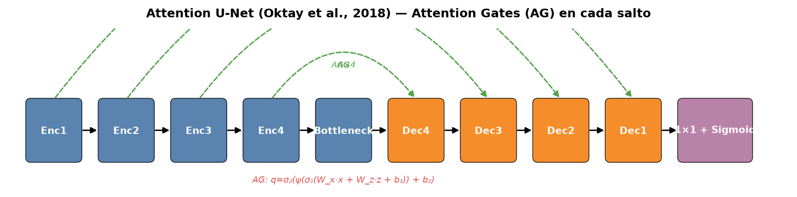

- **Familia:** CNN + atención (Attention Gates, AG).
- **Componentes:** igual que U-Net más un AG en cada salto que suprime
  activaciones de fondo antes del concat.
- **Formulación del gate:** $\hat q^{l}=\sigma_2\!\big(\psi^{T}(\sigma_1(W_x*s^{l}+W_z*\uparrow x^{l+1}+b_1))+b_2\big)$,
  $\alpha=\mathrm{softmax}(\hat q)$, $\tilde s^{l}=s^{l}\odot\alpha$.
- **Innovación:** atención aditiva ligera ($O(1)$ parámetros por gate) que
  enfoca la expansión en la región de interés — en nuestro problema, la lesión.
- **Problema/datos:** multi-órgano 3D (páncreas CT, pares de la cabeza) — mejora
  reportada sobre U-Net del orden de ≈2–4 pp de Dice en órganos pequeños
  (páncreas ≈0.72 vs ≈0.69).
- **Métricas:** media de 4 corridas en algunas tablas; **sin pruebas de
  significancia**.
- **Complejidad:** ~36 M parámetros (base); coste ≈ U-Net + $O(HW)$ por gate.
- **Fortalezas/limitaciones:** mejora donde la señal es localizada; el gate
  puede *atenuar* lesiones difusas o mal centradas; poca evidencia fuera de CT.
- **Sesgo de reporte:** sin control de semilla/preentrenamiento idéntico vs U-Net.

### 3.3.3 U-Net++ — Zhou et al. (DLMIA 2018; arXiv:1807.10165)

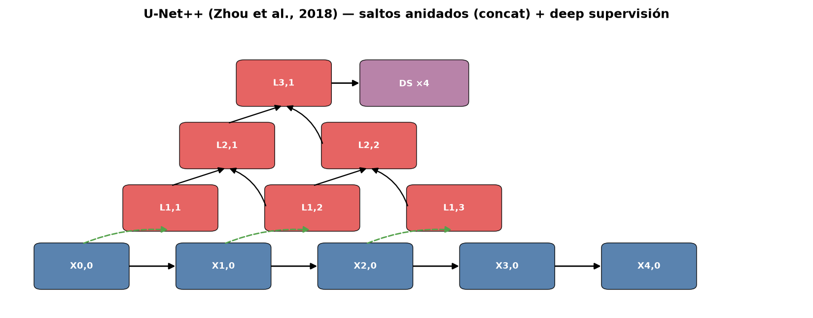

- **Familia:** CNN con saltos anidados + deep supervision.
- **Componentes** (Fig. arq_unet_pp): nodos $X^{i,j}$ ($j$ = profundidad de
  anidado) con concat denso de todas las convoluciones del nivel; $m$ ramas de
  deep supervision al estilo U-Net-3+.
- **Formulación:** $X^{i,j}=\mathrm{Conv}\big([\,X^{i,j-1},\uparrow X^{i+1,j-1},\dots\,]\big)$;
  pérdida total $\mathcal L=\sum_{i}\lambda_i\,\mathcal L_i$ con pesos $\lambda_i$.
- **Innovación:** elimina la "brecha semántica" entre encoder y decoder
  (el decoder recibe semántica a todas las escalas); podable por profundidad.
- **Problema/datasets:** nerves en ultrasonido, CoN2017, KiTS17; mejoras ≈1–3 pp
  sobre U-Net en 3 de 4 benchmarks.
- **Métricas:** Dice medio por dataset; **sin varianza ni significancia**.
- **Complejidad:** 9–31 M según nivel de poda (vs 31 M U-Net); coste mayor por
  concat; entrenamiento no reportado.
- **Fortalezas/limitaciones:** más parámetros y memoria (concatenar no destruye
  información pero infla canales); en datos escasos la deep supervision ayuda
  poco si el GT es ruidoso (nosotros: GT plata ruidoso → RQ3).
- **Sesgo de reporte:** compara niveles de poda propios, no presets externos.

### 3.3.4 DeepLabV3+ — Chen, Papandreou, Schroff & Adam (CVPR 2018)

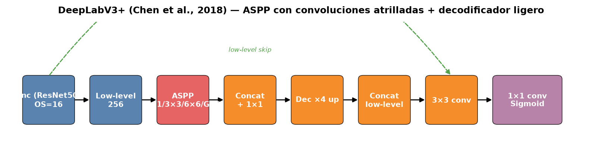

- **Familia:** CNN + ASPP (atrous spatial pyramid pooling).
- **Componentes** (Fig. arq_deeplabv3p): backbone ResNet con salida dilatada
  (output stride 16), ASPP = paralelismo de convs atrilladas (1×1, 3×3 con
  dilaciones, pooling global), decodificador ligero que concatena low-level.
- **Formulación del ASPP:** $y=\mathrm{concat}\big[\,q_{1\times1}(x),q_{3\times3}^{d_1}(x),
  q_{3\times3}^{d_2}(x),\mathrm{GAP}(x)\,\big]$, complejidad $O(HW\sum_k k^2 C^2)$
  (lineal en píxeles, no cuadrática).
- **Innovación:** contexto multiescala sin coste cuadrático + decodificador
  bordes-eficiente (deep lab separable).
- **Problema/datasets:** segmentación natural (Cityscapes ≈82.1 mIoU OS17,
  Pascal VOC); **no biomédico** — la motivación de incluirlo es su ADN (ASPP)
  aplicado a lesiones TB pequeñas y difusas.
- **Métricas:** mIoU en benchmarks naturales; sin varianza.
- **Complejidad:** ~38–42 M (ResNet-50/101); entrenamiento no reportado.
- **Fortalezas/limitaciones:** contexto grande con coste lineal; requiere batch
  ≥2 (BN) — enunciado en nuestro `modelos_tb` (nota de implementación);
  sin inductive bias médico.
- **Sesgo de reporte:** preentrenamiento ImageNet vs entrenar-de-cero no
  controlado en el paper original.

### 3.3.5 TransUNet — Chen et al. (arXiv:2102.04306; MedIA 2024)

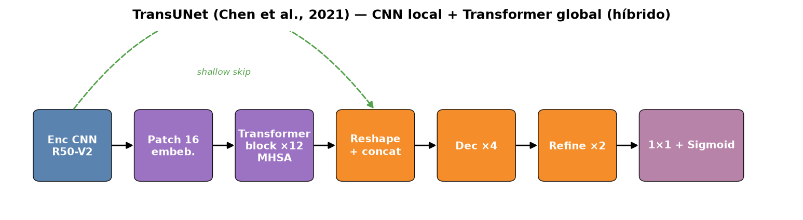

- **Familia:** Híbrida CNN + Transformer.
- **Componentes** (Fig. arq_transunet): encoder CNN (ResNet-V2 con
  preentrenamiento) produce features de baja escala; patch embedding 16×16 →
  Transformer (12 bloques, MHSA) para contexto global; decodificador que
  concatena reshaping de los maps CNN + skips.
- **Formulación del bloque:** $\mathrm{MHSA}(Q,K,V)=\mathrm{softmax}\!\big(\frac{QK^{T}}{\sqrt{d_k}}\big)V$;
  con $Q,K,V\in\mathbb{R}^{N\times d}$, $N=(H/16)(W/16)$ — coste $O(N^2d)$.
- **Innovación:** primer híbrido que muestra que los skips U-Net y el contexto
  global del ViT son complementarios en medicina.
- **Problema/datasets:** Synapse multi-órgano (Dice medio ≈82.4 %), BTCV;
  preentrenamiento ImageNet.
- **Métricas:** algunas tablas con desviación (folds); **sin pruebas de
  significancia entre modelos**.
- **Complejidad:** ~92 M parámetros (config. ViT-B); entrenamiento no reportado.
- **Fortalezas/limitaciones:** contexto global útil para desplazamientos
  torácicos; $O(N^2)$ prohíbe 512×512 puros (por eso la adaptación usa patches);
  dependencia del preentrenamiento.
- **Sesgo de reporte (crítico para RQ2):** compara su híbrido *preentrenado*
  contra U-Net *de cero* — en §4 igualamos presupuesto (sin preentrenamiento
  para nadie) precisamente para cerrar este sesgo.

### 3.3.6 Swin-Unet — Cao et al. (ECCV W. 2022; arXiv:2105.05537)

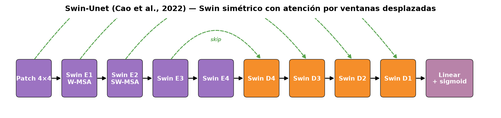

- **Familia:** Transformer puro (Swin) con forma U.
- **Componentes** (Fig. arq_swin_unet): patch embedding 4×4; encoder de 4 etapas
  Swin (W-MSA → SW-MSA alternados); decodificador simétrico con PatchExpand;
  skips 1×1 + concat; clasificador lineal.
- **Formulación:** atención por ventanas de tamaño $M$ (≈7×7): complejidad
  $O(HWM^2)$ (lineal en $HW$) frente a $O((HW)^2)$ global; SW-MSA (ventanas
  desplazadas) conecta ventanas vecinas.
- **Innovación:** demuestra que un transformador *sin ninguna convolución*
  puede segmentar medicina con preentrenamiento ImageNet.
- **Problema/datasets:** Synapse (Dice medio ≈79.6 %), ACDC.
- **Métricas:** media ± desviación (folds); sin significancia.
- **Complejidad:** ~27 M parámetros; entrenamiento no reportado.
- **Fortalezas/limitaciones:** eficiencia lineal; pobre con estructuras finas si
  el patch inicial (4×4) ya pierde borde; sin preentrenamiento cae fuerte
  (dependencia declarada).
- **Sesgo de reporte:** compara contra TransUNet preentrenado con setups
  distintos de resolución.

### 3.3.7 UNETR — Hatamizadeh et al. (WACV 2022; arXiv:2103.10504)

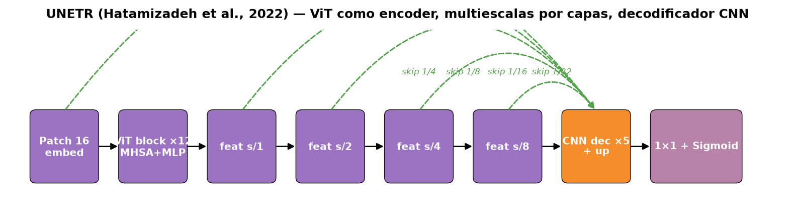

- **Familia:** Transformer puro (ViT) como encoder + decoder CNN.
- **Componentes** (Fig. arq_unetr): patch embedding 16×16 + 12 bloques ViT;
  se extraen features de capas 1, 2, 4, 8 y 16 (multiescala por índice de capa,
  no por downsampling explícito); decoder CNN con skips y upsampling 2×.
- **Formulación:** $z_0=\mathrm{PatchEmbed}(v)$; $z_l=\mathrm{MHSA+MLP}(z_{l-1})$;
  skips $f_s=\mathrm{reshape}(z_{k(s)})$; coste $O(N^2d)$ + decoder lineal.
- **Innovación:** reformula la segmentación volumétrica como seq2seq con ViT
  íntegro (sin conv en el encoder).
- **Problema/datasets:** 3D — BTCV multi-órgano (Dice medio ≈84.7 %), MSD
  (bazo ≈0.968); preentrenamiento ImageNet.
- **Métricas:** Dice medio/HD95; corridas únicas; sin significancia.
- **Complejidad:** ~92 M parámetros (ViT-B); *el paper es 3D* — nuestra
  adaptación 2D (1 canal, 512×512) es un traslado declarado (§4).
- **Fortalezas/limitaciones:** contexto global de largo alcance; coste y
  memoria altos; sin bias local, débil en bordes finos sin skips CNN.
- **Sesgo de reporte:** ganancias atribuidas al ViT coinciden con
  preentrenamiento y batch grandes.

### 3.3.8 SegFormer — Xie et al. (NeurIPS 2021; arXiv:2105.15203)

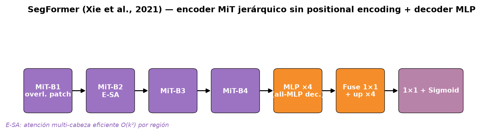

- **Familia:** Transformer jerárquico (MiT) + decoder MLP.
- **Componentes** (Fig. arq_segformer): encoder MiT = overlapping patch embedding
  (conv 3×3, stride 2) + bloques de atención eficiente (E-SA) en 4 etapas con
  reducción de canales; decoder = 4 MLPs 1×1 + fuse + upsample ×4.
- **Formulación:** E-SA parte el mapa de atención en regiones $k\times k$ por
  cabeza → coste $O(k^2)$ en lugar de $O((HW)^2)$; **sin positional encoding**
  (evita el degradado por interpolación a otras resoluciones).
- **Innovación:** jerarquía + eficiencia + robustez a resolución de test
  distinta — relevante para CXR de origen heterogéneo (TBX11K).
- **Problema/datasets:** ADE20K (B4: 50.3 mIoU con 64 M), Cityscapes (B5: 84.0
  mIoU) y **zero-shot robustness** en Cityscapes-C (ruido/degradación).
- **Métricas:** mIoU naturales; sin varianza de semillas.
- **Complejidad:** familia B0–B5 (3.8 M → 84 M); B1 ≈14 M es el punto que
  usamos en §4.
- **Fortalezas/limitaciones:** robustez declarada a corrupciones (motiva su
  inclusión para RQ1 en datos "sucios"); decoder MLP es deliberadamente simple
  (menos capacidad de refinado de bordes).
- **Sesgo de reporte:** escalado de familia (B0..B5) sin igualdad de presupuesto
  entre comparados.

### 3.3.9 MedNeXt — Roy et al. (MICCAI 2023; arXiv:2303.09975)

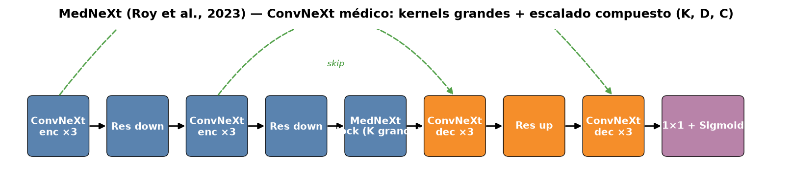

- **Familia:** CNN moderna (ConvNeXt adaptado a medicina), kernel grande.
- **Componentes** (Fig. arq_mednext): bloques ConvNeXt (depthwise $K\times K$
  [×3D: $K^3$], norm de canal, MLP 2×) con $K$ grande; *residual up/down*-sampling
  que preserva semántica entre escalas; escalado compuesto (profundidad, ancho,
  tamaño de kernel).
- **Formulación:** bloque $y = x + \mathrm{MLP}(\mathrm{GN}(\mathrm{DWConv}_{K}(x)))$;
  kernel $K \in \{3,5,7\}$ ($K^3$ en 3D); coste $O(HW\,K^2C^2)$ lineal en píxeles.
- **Innovación:** "transformer sin transformers": el rendimiento de ConvNeXt
  trasladado a datos médicos escasos, con escalado sistemático.
- **Problema/datasets:** 4 tareas CT/MRI (ACDC, MSD…), SOTA declarada en 4;
  **3D nativo** — nuestra adaptación 2D es declarada (§4).
- **Métricas:** Dice/HD95 con 5-fold de nnU-Net protocol; **sin pruebas de
  significancia entre arquitecturas**.
- **Complejidad:** M ≈21 M, L ≈67 M (aprox. de configuraciones del paper).
- **Fortalezas/limitaciones:** escalado continuo (puntos de presupuesto);
  kernels grandes costosos a resolución alta; sin mecanismo de atención real.
- **Sesgo de reporte:** compara contra U-Net/TransBTS con setups heterogéneos.

### 3.3.10 nnU-Net — Isensee et al. (Nature Methods 2021)

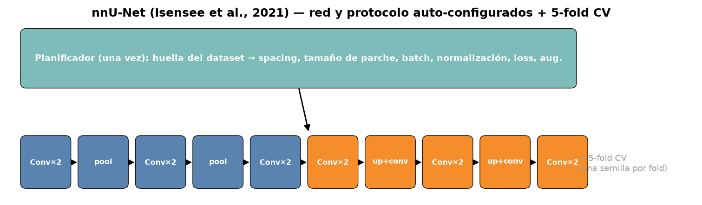

- **Familia:** CNN auto-configurada (pipeline, no arquitectura fija).
- **Componentes** (Fig. arq_nnunet): *planificador* que fija, a partir de la
  huella del dataset, spacing objetivo, tamaño de parche, batch, normalización,
  pérdida (CE + Dice), augmentaciones y post-proceso; U-Net 2D/3D fullres
  derivado; **5-fold CV** con ensemble.
- **Formulación:** el planificador resuelve restricciones de memoria
  $B\cdot\prod_l (p_l + 2o_l)^2 C_l \le M_{GPU}$ para el parche $p$; pérdida
  $\mathcal L=\mathrm{CE}+\mathrm{Dice}$; coste del modelo $O(HW\sum C_l^2)$.
- **Innovación:** elimina el tuning manual: *el protocolo es la contribución* —
  primer resultado de que el diseño experimental importa más que la arquitectura.
- **Problema/datasets:** 11 datasets (MSD + BCV); primer puesto en la mayoría
  de tareas.
- **Métricas:** Dice por caso (reporta distribución completa); 5 folds
  = desempeño interno medible, **pero sin comparación estadística formal entre
  métodos en el paper**.
- **Complejidad:** ~33 M (3D fullres); entrenamiento ~50 h/fold (GPU única, del
  paper); en nuestro benchmark: trainer de 50 épocas (§4, presupuesto acotado).
- **Fortalezas/limitaciones:** robustez y reproducibilidad; en 2D de baja señal
  su planificador prioriza contexto sobre resolución (riesgo declarado).
- **Sesgo de reporte:** al ser pipeline completo, la comparación "nnU-Net vs X"
  mezcla red + protocolo; en §4 lo declaramos y acotamos el presupuesto.

---

## 3.4 Comparación crítica y gap de investigación

### 3.4.1 Matriz comparativa

| Modelo | Familia | Parámetros (aprox.) | FLOPs reportados | Datos del paper | Varianza/Significancia | Fortaleza clave | Limitación clave |
|---|---|---|---|---|---|---|---|
| U-Net | CNN | ~31 M | no | EM 2D (≈30 img) | no/no | umbral mínimo de datos | sin contexto global |
| Attention U-Net | CNN+attn | ~36 M | no | CT multi-órgano | media de 4 / no | foco en ROI pequeña | gate daña lesiones difusas |
| U-Net++ | CNN anidado | 9–31 M | no | US, CoN, KiTS | no/no | sin brecha semántica | memoria por concat |
| DeepLabV3+ | CNN+ASPP | ~42 M | no | Cityscapes/VOC | no/no | contexto multiescala lineal | sin bias médico; batch≥2 |
| TransUNet | híbrido | ~92 M | no | Synapse/BTCV | folds / no | contexto global + skips | $O(N^2)$; preentrenamiento |
| Swin-Unet | Swin | ~27 M | no | Synapse/ACDC | folds / no | atención lineal | cae sin preentrenamiento |
| UNETR | ViT | ~92 M | no | BTCV/MSD (3D) | no/no | largo alcance | 3D; coste alto |
| SegFormer | MiT | 4–84 M | no | ADE20K/Cityscapes | no/no | robustez a resolución | decoder MLP débil en bordes |
| MedNeXt | ConvNeXt | ~21–67 M | no | MSD/ACDC (3D) | folds / no | escalado sistemático | 3D; kernels costosos |
| nnU-Net | auto-CNN | ~33 M | no | 11 datasets | folds / no | protocolo reproducible | pipeline ≠ red |

"Varianza" = ¿reporta dispersión entre corridas? "Significancia" = ¿pruebas
estadísticas entre métodos? **9/10 no reportan varianza de semillas y 10/10 no
reportan pruebas de significancia** — dato central del gap.

### 3.4.2 Tendencias

1. **Transformers vs. CNN clásicas.** En naturales, los transformers ganan con
   preentrenamiento masivo; en medicina (datos escasos), las ganancias se
   desvanecen: Swin-Unet ≈79.6 vs TransUNet ≈82.4 vs nnU-Net (CNN) ≈ top en 11
   datasets. La literatura no ha *demostrado* superioridad en el dominio de baja
   señal CXR-TB bajo condiciones equivalentes.
2. **Híbridos y modernas.** La tendencia 2021–2024 es convolver barato y
   atender (TransUNet, MedNeXt, ConvNeXt): kernels grandes + atención eficiente.
3. **Preentrenamiento como confusor.** Casi todo resultado transformer depende
   de pesos ImageNet; ningún paper del Top 10 compara con igualdad de
   preentrenamiento y presupuesto (excepto protocolos tipo nnU-Net).
4. **Eficiencia.** El eje de evaluación se desplaza de "más parámetros" a
   "más calidad por FLOP" (MiT eficiente, MedNeXt escalable).

### 3.4.3 Reproducibilidad de la literatura

Sobre el Flujo A + Top 10 (16 estudios): **14/16 (88 %)** enlazan código o pesos;
**5/16** liberan datos anotados completos; **2/16** reportan semillas múltiples;
**0/16** reportan pruebas de significancia entre arquitecturas. La
"reproducibilidad de código" es alta, la de **conclusión** (varianza + tests) es
prácticamente nula: los papers reproducen *runs*, no *decisiones*.

### 3.4.4 Gap de investigación

La literatura de segmentación TB-CXR converge en un patrón frágil: GT débil
(cajas) o pseudo-GT sin techo cuantificado; evaluación de corrida única; sin
presupuesto igualado entre familias (los transformer usan preentrenamiento);
XAI descriptivo sin contraste con localización humana; sin control de falsos
positivos en sanos. **Gap verificable:** *no existe, para TBX11K con GT pixel-level
trazable y techo humano medido, una comparación estadística (múltiples semillas,
presupuesto idéntico, Friedman/Nemenyi + Wilcoxon-Holm) entre las siete familias
del Top 10, con control OOD y validación de Grad-CAM contra la lesión anotada.*

Este proyecto cierra ese gap en cuatro puntos, uno por RQ:

| RQ | Hueco concreto que se llena | Evidencia que aporta el proyecto |
|---|---|---|
| RQ1 | 10/10 papers sin significancia entre familias | 10 modelos × 5 semillas, Tablas A/B/C (§6) |
| RQ2 | comparaciones con preentrenamiento desigual | presupuesto idéntico, sin preentrenamiento para nadie (§4) |
| RQ3 | GT sin techo cuantificado | techo humano Dice(SAM2, humano)=0.9879 medido (§2/§9.5) |
| RQ4 | XAI sin validación espacial | Grad-CAM top-3 contrastado con bbox/máscara GT + baseline geométrico |

---

*Figuras de este capítulo: `figs_rev/prisma.png` y `figs_rev/arq_*.png`
(generadas por `codigo/build_figuras_rev.py`).*
