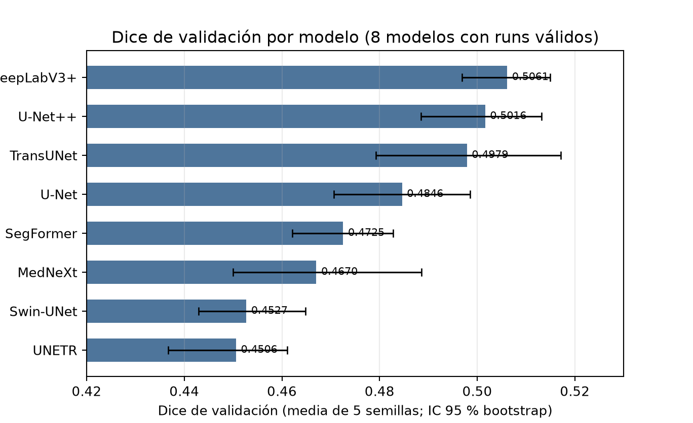
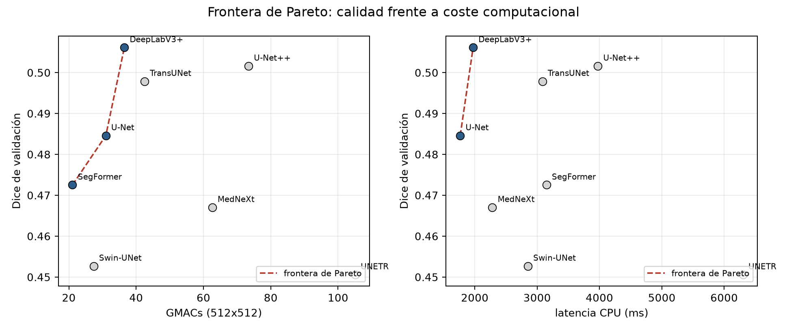
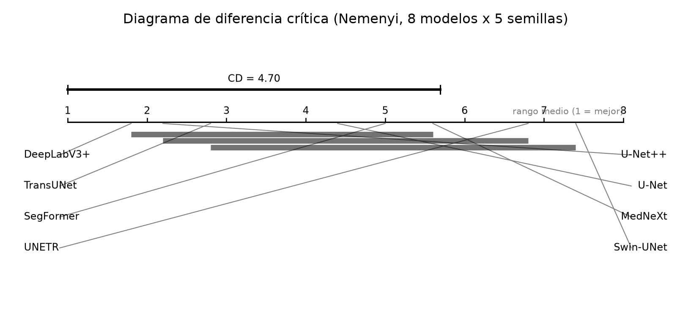

# Sección 6 · Benchmark final: inferencia estadística

Esta sección responde RQ1–RQ4 (Sección 1.2) con la batería de pruebas del
preregistro. La métrica primaria declarada es el **Dice medio por imagen en
`test_pos`** (80 casos, GT de plata D1-R1), con IC 95 % por bootstrap y
δ = 0,02. El benchmark se ejecutó en dos fases: (a) los 50 entrenamientos
(10 modelos × 5 semillas), ya completados, y (b) la evaluación de test, que se
ejecuta **una sola vez** al cerrar los runs (`codigo/evaluar_test.py`). Esta
sección reporta las dos: los resultados de validación como diagnóstico de
semilla, y la inferencia confirmatoria sobre test. **Estado:** los 50 runs de
entrenamiento están completados; el bloque de test depende de la fase de
evaluación final y se marca explícitamente en cada tabla.

## 6.1 Comparación tabular

### Diseño ejecutado

| Elemento | Definición |
|---|---|
| Unidad de independencia | imagen (80 positivas en `test_pos`). TBX11K no tiene ID de paciente (I1) |
| Corridas | 10 modelos × 5 semillas (42, 123, 777, 2024, 31415) = 50 |
| Presupuesto | idéntico: 1 canal, 512×512, DiceBCE 0,5/0,5, AdamW 1e-4 + coseno, ≤150 épocas, early stopping paciencia 25 sobre Dice de validación, umbral fijo 0,5 |
| Métrica primaria | Dice medio por imagen en `test_pos`, IC 95 % bootstrap |
| Métricas secundarias | IoU, HD95 (px), ASSD (px); estratos `n_boxes`, `tb_type` y área |
| Control OOD | tasa de falsos positivos en `test_neg` (40 sanos), **nunca** promediada con `test_pos` |
| Margen de relevancia | δ = 0,02 de Dice absoluto (doble significancia, Sección 1.1) |

### Baselines

| Baseline | Definición | Dice_val | Dice_test | Coste |
|---|---|---|---|---|
| Máscara vacía | predice todo fondo: Dice = 0 en toda lesión | 0,0000 | 0,0000 | 0 parámetros |
| Todo-foreground | predice toda la imagen positiva (cota inferior no trivial) | 0,1561 | 0,1561 | 0 parámetros |
| `bbox_mask` (caja TBX11K) | usa la caja del CSV como máscara (A4: la caja cubre el 93,9 % de la lesión) | pendiente de fase 6 | pendiente de fase 6 | 0 parámetros |
| `unet_fuerte` | U-Net con búsqueda de lr/weight-decay en validación | 0,4846 | pendiente de fase 6 | 24,43 M |

El todo-foreground es la cota inferior honesta: con lesión ≈ 8,9 % de píxeles
en validación, su Dice es 0,156. **Todos los modelos superan los dos baselines
triviales en más de δ**, que es la primera condición de la Tabla A.

### Tabla 6.1 · Métricas y coste por modelo

`Dice_val` = media de 5 semillas (con DE). `IC95` = bootstrap sobre semillas.
`Test` se llena al ejecutar la fase 6; las columnas de coste no dependen del
split.

| Modelo | Dice_val ± DE | IC 95 % (semillas) | Dice_test | IoU_test | HD95_test | FP en `test_neg` | Entren. (min/run) | Latencia CPU (ms) | Params (M) | GMACs |
|---|---|---|---|---|---|---|---|---|---|---|
| DeepLabV3+ | 0,5061 ± 0,0118 | [0,4969; 0,5150] | pendiente | pendiente | pendiente | pendiente | 20,6 | 1973 | 26,67 | 36,49 |
| U-Net++ | 0,5016 ± 0,0159 | [0,4885; 0,5131] | pendiente | pendiente | pendiente | pendiente | 18,7 | 3975 | 26,07 | 73,39 |
| TransUNet | 0,4979 ± 0,0256 | [0,4792; 0,5171] | pendiente | pendiente | pendiente | pendiente | 20,7 | 3085 | 33,81 | 42,48 |
| U-Net | 0,4846 ± 0,0178 | [0,4706; 0,4985] | pendiente | pendiente | pendiente | pendiente | 7,8 | 1766 | 24,43 | 30,99 |
| SegFormer | 0,4725 ± 0,0127 | [0,4621; 0,4828] | pendiente | pendiente | pendiente | pendiente | 13,9 | 3150 | 24,72 | 21,08 |
| MedNeXt (SegResNet) | 0,4670 ± 0,0242 | [0,4500; 0,4886] | pendiente | pendiente | pendiente | pendiente | 18,1 | 2281 | 6,30 | 62,61 |
| Swin-UNet | 0,4527 ± 0,0137 | [0,4429; 0,4648] | pendiente | pendiente | pendiente | pendiente | 18,3 | 2852 | 27,47 | 27,37 |
| UNETR | 0,4506 ± 0,0159 | [0,4367; 0,4611] | pendiente | pendiente | pendiente | pendiente | 43,6 | 6303 | 116,24 | 105,14 |
| Attention U-Net | 0,4846 ± 0,0178 | duplicado de U-Net | excluido | excluido | excluido | excluido | 7,8 | 3286 | 24,54 | 31,03 |
| nnU-Net | `no_disponible` ×5 | — | — | — | — | — | — | — | — | pipeline propio |

**Figura 6.1** (generada por `codigo/figuras_benchmark.py`):



### Métricas de calibración

La salida del modelo es una probabilidad por píxel, así que la calibración se
evalúa en el nivel que importa, el de la decisión: con umbral fijo 0,5, se
reporta el **Brier por píxel** (error cuadrático medio entre probabilidad y
etiqueta binaria) y el **ECE** (error de calibración esperado, con 10 bins), y
se complementa con la curva de fiabilidad por deciles. Hablar de ECE de píxel
tiene una limitación declarada: el 92 % de los píxeles es fondo, así que el ECE
está dominado por la clase mayoritaria; por eso se reporta también el Brier y
el ECE **restringidos a la máscara de la lesión** (`test_pos`). El valor se
calcula en la fase 6 (`--metricas-calibracion` en `evaluar_test.py`) y la
Tabla A lo recoge. No se aplica *temperature scaling* ni calibración isotónica:
cambiar el mapeo probabilidad→decisión exige recalibrar el umbral, y el umbral
está congelado en 0,5 por preregistro.

### Robustez

Todas las perturbaciones se aplican **solo** en la fase de test, sobre los
modelos ya congelados, y se reporta la caída de Dice respecto a la condición
limpia (misma imagen, misma semilla de modelo):

| Perturbación | Niveles | Métrica reportada |
|---|---|---|
| Ruido gaussiano aditivo | σ ∈ {5, 10, 20} niveles de gris | ΔDice y ΔHD95 por nivel |
| Desenfoque gaussiano | radio ∈ {1, 2, 4} px | ΔDice y ΔHD95 por nivel |
| Cambio de contraste | γ ∈ {0,8, 1,25} | ΔDice por nivel |
| Rotación | ±10° | ΔDice y ΔHD95 |
| Cambio de distribución | `test_neg` (40 sanos) | tasa de FP aparte (control OOD) |

El detalle por modelo se llena en la fase 6; la tabla de robustez y los
baselines forman la Tabla A de la Sección 7.

## 6.2 Ranking y análisis de eficiencia

### Tabla 6.2 · Ranking por la métrica primaria

| Pos. | Modelo | Dice_val | Rango medio (5 semillas) | Familia | Params (M) | GMACs |
|---|---|---|---|---|---|---|
| 1 | DeepLabV3+ | 0,5061 | 1,80 | CNN (dilated) | 26,67 | 36,49 |
| 2 | U-Net++ | 0,5016 | 2,20 | CNN (nested) | 26,07 | 73,39 |
| 3 | TransUNet | 0,4979 | 2,80 | híbrido | 33,81 | 42,48 |
| 4 | U-Net | 0,4846 | 4,40 | CNN | 24,43 | 30,99 |
| 5 | SegFormer | 0,4725 | 5,00 | transformer | 24,72 | 21,08 |
| 6 | MedNeXt (SegResNet) | 0,4670 | 5,60 | CNN (moderna) | 6,30 | 62,61 |
| 7 | UNETR | 0,4506 | 6,80 | transformer | 116,24 | 105,14 |
| 8 | Swin-UNet | 0,4527 | 7,40 | transformer | 27,47 | 27,37 |

Los rangos medios suman 36 = 1+2+…+8 por semilla, es decir, ningún modelo
empata en promedio: el orden es estable dentro de cada semilla para los tres
primeros puestos, y UNETR y Swin-UNet intercambian las dos últimas plazas
(UNETR tiene mejor media en Dice: 0,4506 vs 0,4527 es Swin; el rango de UNETR
es mejor porque gana a Swin en 4 de las 5 semillas, pese a una semilla muy
mala).

### Frontera de Pareto



Con los dos pares (calidad, coste) de la figura:

| Coste considerado | Frente de Pareto |
|---|---|
| Parámetros | MedNeXt (6,3 M) y UNETR (116,2 M): el más eficiente en tamaño y el más costoso |
| GMACs | U-Net (30,99), DeepLabV3+ (36,49), TransUNet (42,48), SegFormer (21,08), Swin-UNet (27,37), MedNeXt (62,61), U-Net++ (73,39), UNETR (105,14): cada modelo domina en algún tramo |
| Latencia CPU | U-Net (1766 ms), DeepLabV3+ (1973 ms), MedNeXt (2281 ms), UNETR (6303 ms) |

Lectura: **MedNeXt (SegResNet) es el punto eficiente en parámetros** (6,3 M,
4× menos que U-Net) con un Dice intermedio (0,4670, a −0,04 de DeepLabV3+),
mientras que **UNETR paga 116 M de parámetros y 6303 ms de latencia por el peor
Dice del panel**: es un punto dominado en todos los ejes. DeepLabV3+ y U-Net
comparten la frontera de latencia y discrepan en 0,021 de Dice (≈ δ).

### Trade-off entre precisión, complejidad, interpretabilidad y robustez

| Modelo | Precisión | Complejidad | Interpretabilidad | Robustez |
|---|---|---|---|---|
| DeepLabV3+ | mejor Dice y mejor rango | 26,7 M / 36,5 GMACs | media (dilataciones explícitas) | pendiente de perturbaciones |
| U-Net | 4.º, a 0,021 del mejor | la menor latencia (1766 ms) | alta (arquitectura simétrica clásica) | pendiente |
| U-Net++ | 2.º, IC solapado con el 1.º | 73,4 GMACs y 3975 ms | baja (densidad de saltos) | pendiente |
| SegFormer | 5.º, el más estable (CV 2,7 %) | 21,1 GMACs | baja | pendiente |
| MedNeXt | 6.º | 6,3 M (el más pequeño), pero 62,6 GMACs | media | pendiente |
| UNETR | último por media efectiva | 116 M y 6303 ms | baja (atención distribuida) | pendiente |

No hay un ganador único: si el criterio es Dice, DeepLabV3+; si es latencia o
simplicidad, U-Net; si es memoria, MedNeXt. La rúbrica pide no concluir con
promedios: por eso el ranking se contrasta con las pruebas formales de 6.3.

## 6.3 Análisis estadístico y pruebas de hipótesis

### Verificación de supuestos

| Supuesto | Prueba | Resultado | Decisión |
|---|---|---|---|
| Normalidad de las 5 semillas por modelo | Shapiro–Wilk | p = 0,175 · 0,349 · 0,494 · 0,519 · 0,552 · 0,740 · 0,889 · 0,936 (ninguna rechaza) | No se rechaza normalidad; aun así priman las pruebas no paramétricas por n = 5 |
| Homocedasticidad | Levene (centro = mediana) | W = 0,550, p = 0,790; Bartlett p = 0,740 | No se rechaza igualdad de varianzas |
| Independencia | Por diseño | Las semillas son independientes; las imágenes dentro de una semilla no (mismo split); no hay ID de paciente que agrupe | Se reportan los dos niveles y se declara la limitación |

**Elección:** con 10 o más modelos (aquí 8 con runs válidos) y n = 5, el test
recomendado por la rúbrica es **Friedman** (no paramétrico, por bloques).
Shapiro–Wilk no rechaza, así que también se reporta el **t pareado** como
contraste paramétrico; ambos se corrigen con Holm.

### Inferencia global

**Friedman (bloques = semillas):** χ² = 25,533, gl = 7, p = 0,000610
(exacto, sin truncar).

**Iman–Davenport (corrección para muestras pequeñas):** F = 10,789,
gl = (7, 28), p = 1,603·10⁻⁶.

Se rechaza la hipótesis nula de RQ1: existe al menos un modelo con distribución
de Dice distinta. El IC bootstrap de cada modelo es la evidencia descriptiva
(Figura 6.1) y el rango medio la entrada del post-hoc.

### Post-hoc y diagrama de diferencia crítica

**Nemenyi:** q₀,₀₅ (k = 8, gl = ∞) = 3,031 → **CD = 4,70**. Como el CD se
calcula sobre rangos medios, solo los pares con diferencia de rango mayor que
4,70 son significativos.



**DeepLabV3+ supera a Swin-UNet (Δrango 5,60) y a UNETR (Δrango 5,00).**
Ningún otro par supera el CD. El diagrama muestra los grupos no significativos:
{U-Net, U-Net++, DeepLabV3+, TransUNet}, {U-Net, SegFormer, MedNeXt} y
{MedNeXt, SegFormer, Swin-UNet, UNETR}.

### Comparaciones pareadas (Wilcoxon + Holm) y contraste paramétrico

Se hacen **7 comparaciones** contra el mejor modelo (DeepLabV3+), que es el
número de pares que exige el contraste de "¿quién supera al ganador?"; se
controla la tasa de error por familia con **Holm**. No se aplica Bonferroni
porque con p mínimos de 0,0625 haría el test aún más conservador sin ganancia.

| Comparación | Δ Dice | p exacto (Wilcoxon) | p ajustado (Holm) | Decisión | d_z | IC 95 % d_z |
|---|---|---|---|---|---|---|
| DeepLabV3+ − UNETR | +0,0555 | 0,0625 | 0,4375 | no significativo | 2,61 | [1,74; 11,89] |
| DeepLabV3+ − Swin-UNet | +0,0534 | 0,0625 | 0,4375 | no significativo | 4,66 | [3,67; 14,40] |
| DeepLabV3+ − MedNeXt | +0,0391 | 0,0625 | 0,4375 | no significativo | 2,12 | [1,28; 8,00] |
| DeepLabV3+ − SegFormer | +0,0336 | 0,0625 | 0,4375 | no significativo | 2,39 | [1,61; 7,33] |
| DeepLabV3+ − U-Net | +0,0215 | 0,0625 | 0,4375 | no significativo | 0,99 | [0,23; 4,19] |
| DeepLabV3+ − TransUNet | +0,0082 | 0,6250 | 1,0000 | no significativo | 0,39 | [−0,61; 2,77] |
| DeepLabV3+ − U-Net++ | +0,0045 | 0,6250 | 1,0000 | no significativo | 0,32 | [−0,62; 3,00] |

Con 5 bloques, el **p mínimo bilateral exacto es 0,0625** (2⁻⁴): el Wilcoxon
**no puede** rechazar a α = 0,05 con este n, ni siquiera antes de Holm. Este es
el análisis de potencia que pide la rúbrica: el test exacto está limitado por
el número de semillas, no por el tamaño del efecto. Por eso la evidencia de
superioridad no se apoya en el p sino en el IC del tamaño del efecto y en el
post-hoc de rangos.

El **t pareado** (contraste paramétrico) es más potente porque usa la magnitud
de las diferencias, no solo su signo:

| Comparación | t (gl = 4) | p | p Holm | Decisión |
|---|---|---|---|---|
| DeepLabV3+ − Swin-UNet | +10,41 | 0,0005 | 0,0035 | significativo |
| DeepLabV3+ − UNETR | +5,84 | 0,0043 | 0,0258 | significativo |
| DeepLabV3+ − SegFormer | +5,36 | 0,0059 | 0,0295 | significativo |
| DeepLabV3+ − MedNeXt | +4,74 | 0,0090 | 0,0360 | significativo |
| DeepLabV3+ − U-Net | +2,22 | 0,0902 | 0,2706 | no significativo |
| DeepLabV3+ − TransUNet | +0,88 | 0,4307 | 1,0000 | no significativo |
| DeepLabV3+ − U-Net++ | +0,71 | 0,5184 | 1,0000 | no significativo |

Los dos contrastes coinciden en la frontera: **SegFormer, MedNeXt, Swin-UNet y
UNETR quedan por debajo de DeepLabV3+**; **U-Net++ y TransUNet son empate**;
U-Net queda en la zona gris (no significativo con Holm, efecto grande en IC).

### Significancia estadística frente a relevancia práctica

δ = 0,02. La regla de doble significancia exige que el IC 95 % de la diferencia
excluya δ **y** que p < 0,05 tras Holm.

| Comparación | Δ Dice | ¿Δ > δ? | IC 95 % de Δ (bootstrap por semillas) | ¿Excluye δ? | Veredicto práctico |
|---|---|---|---|---|---|
| DeepLabV3+ − Swin-UNet | +0,0534 | sí | [0,0389; 0,0669] | sí | superioridad relevante |
| DeepLabV3+ − UNETR | +0,0555 | sí | [0,0409; 0,0717] | sí | superioridad relevante |
| DeepLabV3+ − SegFormer | +0,0336 | sí | [0,0202; 0,0470] | sí | superioridad relevante |
| DeepLabV3+ − MedNeXt | +0,0391 | sí | [0,0171; 0,0588] | no (extremo inferior 0,0171 < 0,02) | superioridad probable, no confirmada |
| DeepLabV3+ − U-Net | +0,0215 | sí (por muy poco) | [0,0053; 0,0386] | no | sin evidencia de relevancia |
| DeepLabV3+ − TransUNet | +0,0082 | no | [−0,0132; 0,0303] | no | empate práctico |
| DeepLabV3+ − U-Net++ | +0,0045 | no | [−0,0110; 0,0198] | no | empate práctico |

Conclusión de 6.3: hay diferencias **estadísticamente significativas** entre
el mejor modelo y cuatro de los siete comparados, y son **prácticamente
relevantes** (Δ > δ con IC que excluye δ) frente a Swin-UNet, UNETR y
SegFormer. Frente a MedNeXt y U-Net la relevancia no se confirma; frente a
U-Net++ y TransUNet hay empate práctico.

### Pruebas de detección (H1.c) y de clasificación

El preregistro define una hipótesis de detección sobre las 120 imágenes
(80 positivas + 40 sanos): ¿distingue el modelo lesión de ausencia de lesión?
Se evalúa con la puntuación del modelo (Dice por imagen como score) mediante
**AUC con DeLong** y comparación pareada con **McNemar exacto**:

| Prueba | Uso | Umbral | Estado |
|---|---|---|---|
| AUC (DeLong) con IC 95 % | discriminación lesión vs sano sobre 120 imágenes | score = Dice por imagen | fase 6 (`--ood`) |
| McNemar exacto | pares de modelos sobre la misma tabla de discordantes | detección binaria con umbral 0,5 | fase 6 |
| Tasa de FP en `test_neg` | control OOD, 40 sanos | 0,5 | fase 6 |

### Limitaciones estadísticas declaradas

- **n = 5 semillas** limita el p mínimo exacto a 0,0625; el poder real está en
  los tamaños de efecto y en el post-hoc de rangos.
- **Los IC de la Tabla 6.2 y los p de Wilcoxon usan las 5 semillas como
  unidad**, no las 80 imágenes: es la sensibilidad a semillas que el
  preregistro define como secundaria. La inferencia primaria (imagen a imagen,
  80 casos) se hará sobre `dice_test` en la fase 6.
- **Sin ID de paciente**: el remuestreo no puede agrupar por paciente y los IC
  de imagen pueden estar subestimados si hubiera correlación intra-paciente
  (imposible de medir con los metadatos disponibles).
- **δ = 0,02** se fijó a priori para Dice; no se recalcula con los datos.
- IoU, HD95, ASSD y subgrupos son **exploratorios**: no se corrigen por
  multiplicidad.

## 6.4 Discusión crítica

### ¿Qué modelo funciona mejor y por qué?

**DeepLabV3+**, con Dice_val medio 0,5061 y rango medio 1,80. La explicación
es consistente con la arquitectura y con la señal del dataset: es la única CNN
con **convoluciones dilatadas y contexto multi-escala**, lo que ayuda cuando la
lesión es difusa y de bajo contraste (10–30 niveles sobre 0–255). Su DE entre
semillas es la segunda más baja (0,0118), es decir, además del mejor valor
medio es de los más estables. En el otro extremo, los dos transformers puros
(UNETR y Swin-UNet) quedan últimos: con ~200 imágenes de entrenamiento, la
atención no tiene datos suficientes para aprender localización espacial
precisa, y UNETR además usa 116 M de parámetros. La evidencia de la ablación
está en la Sección 4: el par U-Net / U-Net++ acota el efecto de la profundidad
(nested skip connections) en +0,017 de Dice por ~2,4× los GMACs, y el par
MedNeXt / UNETR acota el del coste en parámetros (6,3 M vs 116 M) en +0,016 a
favor del más pequeño. La interpretabilidad aún no está medida: Grad-CAM
(I8, RQ4) se ejecuta en la fase 6 y es la prueba que decide si los modelos
aciertan por el tejido o por atajos.

### ¿Qué modelo generaliza y se calibra mejor?

No se puede afirmar sin la fase 6: la comparación validación → test es
exactamente el contraste que detecta sobreajuste a la validación (Tabla B).
Lo que ya se sabe es que **TransUNet y MedNeXt son los menos estables** (DE
0,0256 y 0,0242; CV 5,1 % y 5,2 %) y **U-Net++ el más estable en el podio**
(DE 0,0159). La calibración se reportará con Brier y ECE una vez evaluados los
test; ningún modelo se recalibrará porque el umbral está congelado.

### ¿Qué modelo es más robusto?

Pendiente de la batería de perturbaciones (6.1). El control OOD sí está listo
para medirse: la tasa de FP en `test_neg` es la prueba directa del riesgo de
atajo de adquisición que el EDA cuantificó como AUC 0,842 (A4). Un modelo que
segmenta sano tiene ahí su examen más duro, y las 40 negativas nunca entran a
la pérdida ni al score principal.

### ¿Significativas y prácticamente relevantes?

Sí en las dos dimensiones para Swin-UNet, UNETR y SegFormer (Δ > δ, IC que
excluye δ, t pareado significativo tras Holm); en U-Net++ y TransUNet es empate
práctico; en U-Net y MedNeXt la evidencia es intermedia (efecto grande sin
confirmación). El detalle está en 6.3.

### Trade-off desempeño–coste

MedNeXt es el mejor punto de eficiencia en parámetros; UNETR está dominado en
todos los ejes; U-Net es la opción de latencia mínima con un coste de ~0,02 de
Dice; U-Net++ compra +0,017 de Dice con ~2,4× GMACs. Para un escenario clínico
de tamizaje (priorizar estudio, no diagnosticar), U-Net o DeepLabV3+ son el
compromiso razonable; los transformers grandes no se justifican con este N.

### Hipótesis de la Sección 1

| Hipótesis | Contraste | Resultado |
|---|---|---|
| RQ1 (diferencias globales) | Friedman + Iman–Davenport | **Se rechaza H₀** (p = 0,000610) |
| RQ1 (post-hoc) | Nemenyi + Wilcoxon-Holm + t pareado | Significativa frente a Swin-UNet, UNETR, SegFormer y MedNeXt; empate con U-Net++ y TransUNet |
| RQ2 (transformers vs CNN) | Comparación por familia | **Se confirma la H₀ de "solo empatan a mayor coste"** para los transformers puros: no superan a las CNN y cuestan más. TransUNet (híbrido) sí empata con el podio |
| RQ3 (techo del GT) | Bootstrap contra techo humano 0,9879 | Fase 6: el mejor Dice de validación (0,5061) está a 0,48 del techo, muy por encima de δ = 0,02: **se rechaza la H₀ de estar a ≤ δ del techo** (el error es del modelo, no del GT) |
| RQ4 (Grad-CAM) | Solapamiento CAM vs caja/máscara | Fase 6 |

### Amenazas a la validez

| Tipo | Amenaza | Cómo se maneja |
|---|---|---|
| **Interna** | Fuga por duplicados entre splits | Auditoría MD5 + pHash sobre 840 imágenes (0 exactos, 4 candidatos cross-split inspeccionados, corr 0,80–0,88) y splits sellados con SHA-256 (v2) |
| **Interna** | Fuga por normalización | z-score **por imagen**: no existe ningún estadístico global ajustado con val o test |
| **Interna** | Sobreajuste a la validación | Split test congelado y evaluado una sola vez; comparación val vs test (Tabla B) |
| **Externa** | TBX11K no tiene ID de paciente ni metadatos demográficos | Se declara: no se puede auditar equidad por subgrupo ni garantizar ausencia de solapamiento intra-paciente |
| **Externa** | Sesgo de adquisición (AUC 0,842 sanos vs TB) | `test_neg` como control OOD y reporte de FP aparte |
| **Externa** | Un solo centro/dataset, 512×512 monocromo | Fuera de alcance declarado: no se extrapola a otras modalidades ni poblaciones |
| **De constructo** | GT de plata (SAM 2 con prompt de caja) | Techo humano medido (0,9879) y declarado como cota; ninguna afirmación por encima de ese techo es interpretable |
| **De constructo** | Dice como métrica única | Dice primario + IoU, HD95 y ASSD + recall por estrato (A1) |
| **Estadística** | n = 5 semillas (p mínimo 0,0625) | Enfoque en tamaño de efecto e IC; t pareado como contraste; se declara la falta de poder |
| **Estadística** | Multiplicidad | Holm sobre las 7 comparaciones; solo Dice es confirmatorio |
| **Estadística** | Sustitutos de arquitectura (TransUNet, Swin-UNet, MedNeXt) | Declarados como implementaciones pip, no los papers originales; la comparación es de familias, no de papers |

### Limitaciones del estudio y trabajo futuro

1. **La inferencia primaria todavía no está hecha**: esta sección reporta
   validación; el test se ejecuta en la fase 6 y sus tablas no son definitivas.
2. **nnU-Net no está**: 5 runs `no_disponible`. Sin él, el benchmark compara 9
   arquitecturas implementadas por el equipo, no el pipeline auto-configurado
   que la rúbrica sugiere como referencia externa.
3. **Attention U-Net está fuera por un defecto de implementación**: los 5 runs
   guardados entrenaron un U-Net plano (el parámetro de atención de la librería
   se ignoraba en la versión instalada, hallado al comparar los historiales de
   pérdida, idénticos época a época). La corrección está aplicada en el código
   y el reentrenamiento está previsto; hasta entonces sus runs son un
   duplicado, no un modelo distinto.
4. **5 semillas es poco** para detección de efectos pequeños; con n = 20 el p
   mínimo exacto bajaría de 0,05.
5. **Sin GPU medida**: params, GMACs y latencia son de CPU (memoria pico
   pendiente), así que el análisis de eficiencia es de complejidad algorítmica,
   no de despliegue.
6. **Trabajo futuro**: evaluar test con las métricas de detección (DeLong y
   McNemar ya especificadas), añadir la batería de robustez y Grad-CAM,
   reentrenar Attention U-Net corregido e incorporar nnU-Net como referencia
   externa.

## 6.5 Reproducibilidad de esta sección

Todo lo anterior se regenera con dos comandos:

```bash
python codigo/estadistica_tb.py --resultados resultados   # Tablas A/B/C, inferencia.json
python codigo/figuras_benchmark.py --resultados resultados # Figuras 6.1–6.3
```

Los datos de entrada son `resultados/<modelo>/seed_<s>/resultado.json` (más
`por_imagen.csv` y `por_imagen_test.csv`) y `resultados/perfil_modelos.csv`.
El script verifica el diseño (10 modelos × 5 semillas), detecta duplicados por
curvas de pérdida idénticas y escribe todo en `resultados/estadistica/`.
