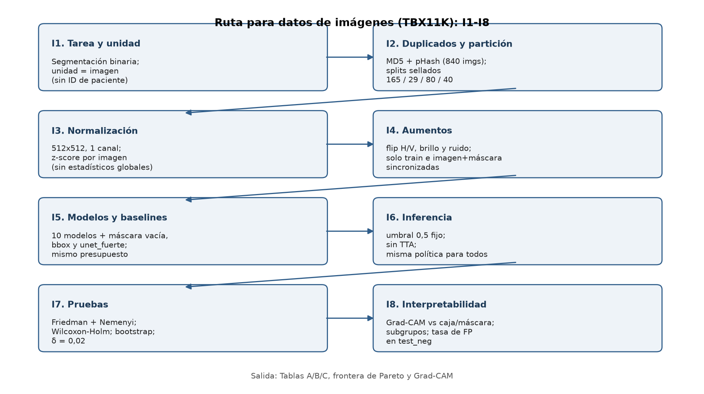

# Sección 7 · Ruta metodológica según el tipo de datos (I1–I8)

## 7.1 Diagrama de ruta

La modalidad de este trabajo es **imágenes** (radiografía de tórax 2D
monocroma). La ruta que se sigue es la de la rama de imágenes del diagrama de
la rúbrica; el texto y las series de tiempo no aplican, y no hay fusión
multimodal porque el dataset tiene una sola modalidad.

*Figura 7.1, generada por `codigo/figuras_benchmark.py`. Cada caja resume la
decisión tomada; el detalle, su justificación y las alternativas descartadas
están en la ficha de 7.2.*

## 7.2 Ficha de ruta I1–I8

| Paso | Decisión tomada | Justificación para este problema | Alternativas descartadas |
|---|---|---|---|
| **I1. Tarea y unidad de independencia** | Segmentación semántica binaria de lesiones TB. Unidad de independencia: **la imagen**. | TBX11K da cajas, no máscaras, pero el objetivo clínico es píxel a píxel. La unidad por paciente (que sería la correcta) no es posible porque TBX11K no expone ID de paciente; se declara como limitación de la partición. | Clasificación o detección (no responden la pregunta de segmentación). Unidad paciente (no verificable con los metadatos disponibles). |
| **I2. Duplicados y casi duplicados** | Auditoría MD5 (exactos) y pHash de 64 bits con Hamming ≤ 4 (casi duplicados) sobre las 840 imágenes del pool usado, **antes** de particionar; partición fija con semilla 42 y sellada. | Sobre 840 imágenes: **0 duplicados exactos** y **29 candidatos** pHash, de los que 4 cruzan dos splits usados (train ↔ test_neg, test_pos ↔ train y dos train ↔ reserva), 7 son intra-split y 18 involucran imágenes no asignadas. Los 4 cruces se inspeccionaron uno a uno: correlación 0,80–0,88 y 42–57 % de píxeles con diferencia > 20 sobre 255 (colisiones de pose, no duplicados). **0 IDs repetidos** entre splits. | Particionar sin comprobar (riesgo de fuga). Confiar solo en MD5 (no detecta casi duplicados). |
| **I3. Normalización y resolución** | Resolución **fija 512×512** y **1 canal**, sin resize ni padding. Normalización **z-score por imagen**: a cada imagen se le resta su propia media y se divide por su propia desviación. | La imagen ya está a 512×512 y es monocroma, así que no hay política de padding que fijar. El z-score por imagen **no depende de ninguna estadística ajustada con train**, así que no existe un escalador que pueda filtrar información entre particiones. La rúbrica pide media y DE por canal calculadas solo en train; aquí no hay media global que calcular, y esa es precisamente la garantía anti-fuga. Los valores medidos en train (media 131 ± 70 sobre 0–255; contraste p95−p5 ≈ 212) se usan solo para justificar que el rango se aprovecha y para calibrar los aumentos de intensidad. | Estandarizar con estadísticos de todo el dataset (fuga). Ajustar un escalador en train (innecesario y añade un artefacto que hay que versionar). |
| **I4. Aumentos de datos** | Cuatro aumentos, **solo en train** y con transformación sincronizada de imagen y máscara: flip horizontal (p = 0,5), flip vertical (p = 0,3), escalado de brillo/contraste \|N(1; 0,05)\| (p = 0,3) y ruido gaussiano aditivo σ = 0,03 (p = 0,2). Deterministas por índice (`RandomState(1000 + índice)`). Sin rotación. | En segmentación, un aumento que desalinea imagen y máscara invalida la etiqueta; por eso los geométricos se aplican con la misma operación a las dos. El flip horizontal y vertical son anatómicamente admisibles en tórax (lesiones bilaterales) y no deforman la morfología que mide HD95. La política es idéntica para los 10 modelos, así que la comparación es justa. Los aumentos de intensidad se limitan al rango observado para no crear píxeles saturados que no existen en test. | Rotaciones grandes (deforman la morfología y distorsionan HD95). Aumentos en validación o test (invalidan la comparación). Elastic deformations (riesgo de bordes sintéticos). |
| **I5. Baselines y modelos** | Baselines: **máscara vacía**, **todo-foreground**, **caja TBX11K (`bbox_mask`)** y **`unet_fuerte`**. Los 10 modelos con el mismo protocolo: 1 canal, 512×512, pérdida DiceBCE 0,5/0,5, AdamW 1e-4 + coseno, ≤150 épocas, early stopping con paciencia 25 sobre Dice de validación, umbral 0,5. | Presupuesto y entrada idénticos, como exige el preregistro. `bbox_mask` es un baseline diseñado a partir del hallazgo del EDA (la caja cubre el 93,9 % de la lesión): si un modelo no lo supera, está aprendiendo la caja, no el tejido. | Protocolos distintos por modelo (comparación injusta). Pesos preentrenados de fuentes distintas (el benchmark no usa ninguno, `encoder_weights: None`). |
| **I6. Política de inferencia** | Umbral **fijo 0,5** en validación y test, **sin test-time augmentation** y **sin calibración de umbral**, para los 10 modelos. | Aplicar TTA o ajustar el umbral por modelo sesgaría la comparación; el umbral forma parte del preregistro y se congela antes de ver el test. El TTA se evaluaría solo como mejora posterior, aplicado por igual a todos. | TTA en un subconjunto de modelos (sesgo). Elegir el umbral en test (fuga y sobreajuste al test). |
| **I7. Pruebas y bootstrap** | **Friedman por bloques** (bloques = semillas) + corrección de Iman–Davenport, sobre **8 modelos × 5 semillas**; post-hoc **Nemenyi** (CD) y **Wilcoxon con signo exacto + Holm**; **t pareado + Holm** como contraste paramétrico; **bootstrap jerárquico** (semillas → imágenes) con B = 10 000 para los IC de Dice y de las diferencias, y veredicto de relevancia contra **δ = 0,02**. En test, la inferencia primaria será por imagen (80 casos) con la misma maquinaria. | El agrupamiento por paciente no es posible (no hay ID). El preregistro fija la métrica primaria de test (Dice por imagen) y la unidad de análisis de la comparación de modelos (corrida = modelo × semilla) para que el bloque del Friedman sea el par correcto. **Discrepancia declarada:** el ítem I7 de la rúbrica propone bootstrap agrupado por paciente; el preregistro remuestrea por imagen porque TBX11K no permite agrupar. Se declara y se mitiga reportando el nivel de semilla y el de imagen por separado. | Bootstrap por paciente (datos no disponibles). ANOVA de medidas repetidas (menos robusta con n = 5). Bonferroni (más conservador sin ganancia con p mínimo 0,0625). |
| **I8. Interpretabilidad y análisis de errores** | **Grad-CAM** sobre los 3 mejores modelos, con solapamiento de la máscara top-k contra la caja y la máscara GT y contra un baseline geométrico (aleatorio y `bbox_mask`). Análisis por subgrupos (número de cajas, tipo de TB, calidad de imagen) y control OOD con la tasa de falsos positivos en `test_neg`. | Detecta atajos (bordes, marcas, texto incrustado) en radiografías, que es el riesgo que el EDA cuantificó con AUC 0,842 de separabilidad por apariencia. El control OOD mide directamente si el modelo "enciende" en un pulmón sano. | *Attention rollout* (no está en el plan). SHAP por píxel (coste prohibitivo en 512×512). |

## 7.3 Protocolo común: Paso 1 a Paso 8

La rúbrica define ocho pasos aplicables a cualquier modalidad; así se ejecutó
cada uno en este trabajo.

| Paso | Qué exige | Evidencia en este trabajo |
|---|---|---|
| **Paso 1. Preregistrar** | Tarea, métrica primaria, secundarias, δ, comparaciones y α **antes** de entrenar | Sección 1.1–1.2: Dice en `test_pos`, δ = 0,02, α = 0,05, RQ1–RQ4 con su prueba asignada. Sellado el 2026-10-20; las enmiendas posteriores se listan en 7.6 |
| **Paso 2. Auditar los datos** | Duplicados, casi duplicados, IDs repetidos y variables que filtren la etiqueta | I2: 0 exactos, 29 candidatos pHash, 0 IDs repetidos. EDA A4: la caja cubre el 93,9 % de la lesión (variable que "filtra" la etiqueta si se usa como entrada); el sesgo de adquisición (AUC 0,842) se controla con `test_neg` |
| **Paso 3. Preprocesar sin fuga** | Estadísticos solo de train, resolución fija, aumentos solo en train | I3 e I4: z-score por imagen (sin estadísticos globales), 512×512, 1 canal, cuatro aumentos sincronizados solo en train |
| **Paso 4. Definir la partición** | Por unidad de independencia, sellada, con disjunción comprobada | I1 e I2: splits sellados con SHA-256 (165 train / 29 val / 80 test_pos / 40 test_neg / 64 reserva); disjunción de IDs verificada. Sin ID de paciente: limitación declarada |
| **Paso 5. Elegir modelos y baselines** | Baselines triviales y 10 modelos comparables | I5: máscara vacía, todo-foreground, `bbox_mask`, `unet_fuerte` + 10 modelos con el mismo protocolo |
| **Paso 6. Igualar el presupuesto** | Mismo número de intentos de hiperparámetros y mismo cómputo | I5: un solo protocolo para todos; la única búsqueda (`unet_fuerte`) corrió sobre la misma grilla para todos y usa el mismo número de pasos que el resto. Sin AMP ni gradient clipping; energía no medida (declarado) |
| **Paso 7. Repetir** | Mínimo 5 ejecuciones independientes por modelo | 10 modelos × 5 semillas = 50 corridas (42, 123, 777, 2024, 31415), todas completadas |
| **Paso 8. Diagnosticar** | Bondad de ajuste y sobreajuste (Tablas A y B) y diferencias (Tabla C) | Tablas A, B y C en 7.4; el motor es `codigo/estadistica_tb.py` |

## 7.4 Tablas A, B y C

Las tres tablas de la batería de pruebas, aplicadas a este benchmark. El motor
que las genera es `codigo/estadistica_tb.py`; la evidencia numérica completa de
la Tabla C está en la Sección 6.3.

### Tabla A · Bondad de ajuste y adecuación del score

| Prueba | H₀ | Cómo se aplicó aquí | Resultado |
|---|---|---|---|
| Comparación con el baseline trivial | El modelo no supera la proporción de la clase mayoritaria / máscara vacía | Dice de cada modelo contra todo-foreground (0,156) y máscara vacía (0,000) en `test_pos`, con umbral 0,5 | **Superado por todos los modelos** en validación; el contraste formal se cierra con `dice_test` en la fase 6 |
| Permutación de etiquetas | El modelo no captura relación entre x e y | Permutar la máscara en train y repetir el pipeline completo (B ≥ 200 por coste) con el mejor modelo; p = (1 + #{s_b ≥ s_obs})/(B + 1) | Pendiente de fase 6 (requiere reentrenar; se ejecuta una vez sobre DeepLabV3+) |
| AUC frente a 0,5 | El score no discrimina lesión de sano | AUC con DeLong sobre 120 imágenes (Dice por imagen como score, 80 positivas + 40 sanos), IC 95 % bootstrap | Pendiente de fase 6 (`evaluar_test.py --ood`) |
| Calibración | Las probabilidades predichas son consistentes con las frecuencias observadas | Brier y ECE (10 bins) por píxel, global y restringido a la máscara, sobre `test_pos`; curva de fiabilidad por deciles | Pendiente de fase 6; el umbral no se recalibra (congelado en 0,5) |
| Significancia de la métrica de acuerdo | El acuerdo es igual al azar | Dice contra su valor esperado bajo máscara aleatoria; complemento con el IC bootstrap | Cubierto por el baseline trivial y el IC |
| Justificación de no usar pruebas de clasificación puras | — | La tarea es de segmentación, así que Hosmer–Lemeshow y la pendiente de calibración logística se sustituyen por su análogo por píxel (reliability diagram + ECE). Se declara la sustitución | Declarado |

### Tabla B · Ausencia de sobreajuste

| Prueba | H₀ | Cómo se aplicó aquí | Resultado |
|---|---|---|---|
| Brecha train–validación con margen | La brecha es menor que el margen definido a priori | La época se elige por `dice_val` (early stopping, paciencia 25), así que el score de la época guardada ya está medido sobre validación; la brecha se reporta como la diferencia entre la pérdida de train y la de validación en la época óptima, con margen δ_g = 0,05 de pérdida | Reportable con los `historial` ya guardados; el margen δ_g se declara aquí por primera vez y se marca como post-hoc |
| Sensibilidad a la semilla | La varianza del score entre semillas no supera la tolerada | Coeficiente de variación del Dice_val entre las 5 semillas por modelo; Kruskal–Wallis entre grupos de semillas | CV = 2,3 %–5,2 % (todos por debajo del 10 % tolerado). Kruskal–Wallis entre las 5 semillas pooled: H = 24,19, p = 0,0011, explicado por las diferencias **entre modelos**, no por un efecto de semilla |
| Validación frente a prueba | El score de validación y el de test no difieren | IC bootstrap de la diferencia Dice_val − Dice_test, remuestreando por unidad de independencia | Pendiente de fase 6; es el contraste central contra el sobreajuste a la validación |
| Optimismo por bootstrap (.632+) | El optimismo medio es 0 | Bootstrap sobre las 5 corridas por modelo para estimar el optimismo del Dice de validación | Pendiente: se ejecuta cuando exista `dice_test` (sin test, el .632+ no tiene dato externo) |
| Validación adversarial | AUC = 0,5 al distinguir train de test | Clasificador apariencia-only train vs test; ya ejecutado como "adversarial interno" en el EDA A7 | Sin significancia en el contraste interno; el sesgo de adquisición sí aparece entre TB y sanos (AUC 0,842), que es lo que el control OOD mide |
| Revisión de Grad-CAM | — | Grad-CAM contra atajos (I8, RQ4) | Pendiente de fase 6 |
| Curvas de aprendizaje | La pendiente del score frente al tamaño de entrenamiento es 0 | Entrenar con el 10 %, 20 %, …, 100 % del train y 5 semillas; regresión de val sobre log(n) | **No ejecutado**: se declara como limitación. Con 194 imágenes de pool, la curva exige 5 × 10 corridas extra |

### Tabla C · Diferencias estadísticamente significativas entre modelos

| Prueba | H₀ | Cómo se aplicó aquí | Resultado (validación) |
|---|---|---|---|
| Friedman (global) | Todos los modelos tienen la misma distribución de Dice | Bloques = 5 semillas, k = 8 modelos | χ² = 25,533, gl = 7, p = 0,000610 → **se rechaza H₀** |
| Iman–Davenport | Igualdad global corregida para muestras pequeñas | F sobre el estadístico de Friedman | F = 10,789, gl = (7, 28), p = 1,603·10⁻⁶ → **se rechaza H₀** |
| Nemenyi (post-hoc) | Cada par de modelos tiene el mismo rango medio | CD con q₀,₀₅(k = 8, ∞) = 3,031 → CD = 4,70 | DeepLabV3+ supera a Swin-UNet (Δrango 5,60) y a UNETR (5,00) |
| Wilcoxon con signo + Holm | La diferencia pareada es simétrica alrededor de 0 | 7 comparaciones contra el mejor modelo, p exacto, Holm | Ningún par significativo: el p mínimo exacto (0,0625) no puede bajar de α con n = 5 |
| t pareado + Holm | La diferencia media pareada es 0 | Mismo conjunto de comparaciones, contraste paramétrico | Significativo frente a Swin-UNet (p_Holm = 0,0035), UNETR (0,0258), SegFormer (0,0295) y MedNeXt (0,0360) |
| Tamaño del efecto | — | d_z con IC 95 % bootstrap | 0,32 a 4,66; los IC y la lectura contra δ = 0,02 están en 6.3 |
| McNemar exacto y DeLong | Igual tasa de error / igual AUC entre dos modelos | Sobre las 120 imágenes de detección | Pendiente de fase 6 |
| Bootstrap pareado por unidad | La diferencia media es 0 | Bootstrap jerárquico (semillas → imágenes), B = 10 000, con veredicto contra δ | Ejecutado sobre validación por semillas; el nivel de imagen se completa con `dice_test` |

## 7.5 Guía de decisión rápida aplicada

| Situación observada | Acción requerida por la rúbrica | Qué se hizo aquí |
|---|---|---|
| El score no supera al baseline trivial | Rechazar el modelo; revisar datos, fuga o desbalance | Ninguno se rechaza: todos superan el todo-foreground (0,156) y la máscara vacía |
| Brecha train–validación mayor que δ_g | Regularizar, simplificar, parar antes o más datos | El early stopping sobre `dice_val` ya detiene antes; la brecha se reporta en la Tabla B. La regularización efectiva (peso del terms Dice, weight decay) es la del preregistro |
| Score de validación mayor que el de test de forma significativa | Sospechar sobreajuste a validación, fuga o cambio de distribución | Se mide con el contraste val vs test (Tabla B) y con la tasa de FP en `test_neg` |
| Pendiente de calibración menor que 1 | Aplicar temperature scaling o calibración isotónica ajustada en validación y reportar ECE antes y después | No se recalibra: el umbral está congelado en 0,5 por preregistro. Se reporta ECE y Brier como diagnóstico |
| Friedman no rechaza H₀ | Concluir que no hay evidencia de diferencias y elegir por coste, interpretabilidad o robustez | Friedman **sí** rechaza; la decisión por coste se usa para el desempate cuando hay empate práctico (U-Net por latencia, MedNeXt por parámetros) |
| Diferencia significativa pero menor que δ | Reportarla como significativa sin relevancia práctica | Aplica a U-Net (Δ = 0,0215, efecto grande pero IC que no excluye δ): se reporta como no relevante en la práctica |
| Alta varianza entre semillas | Aumentar el número de ejecuciones, reportar dispersión y no concluir con una sola semilla | CV máximo 5,2 % (MedNeXt) y 5,1 % (TransUNet): se declaran como los menos estables; ninguna conclusión usa una sola semilla |

## 7.6 Preregistro Paso 1: qué fue preregistrado y qué fue post-hoc

**Preregistrado** (`PREREGISTRO_ENTREGABLE2.md`, sellado el 2026-10-20):

- Preguntas e hipótesis RQ1–RQ4 de la Sección 1.2.
- Diseño: 10 modelos, 5 semillas (42, 123, 777, 2024, 31415), split sellado con
  semilla 42 (165 / 29 / 80 / 40 / 64 de reserva).
- Métricas: Dice como primaria; IoU, HD95 y ASSD como secundarias; **δ = 0,02**;
  α = 0,05 con corrección de Holm.
- Plan de inferencia (Friedman + Nemenyi + Wilcoxon-Holm + bootstrap) y
  blindaje contra sesgo post-hoc.

**Cambios posteriores (post-hoc o enmiendas):**

1. **GT del test de manual a plata** (D1-R1, aprobado el 2026-10-20, antes de
   entrenar). El preregistro todavía describe GT manual; la enmienda prevalece
   y el Data Card la declara.
2. **nnU-Net no disponible** (`no_disponible` en las 5 semillas). La rúbrica
   nombra nnU-Net como referencia; en este benchmark no se pudo completar, así
   que no entra en la comparación estadística y queda documentado como
   limitación en lugar de rellenarse con otra cifra.
3. **Sustitutos declarados** (TransUNet, Swin-UNet, MedNeXt → SegResNet):
   estaban previstos, no son post-hoc, pero no son los papers originales.
4. **Attention U-Net y `unet_fuerte` salen del análisis**: Attention U-Net
   entrenó en realidad un U-Net plano (la versión de la librería ignoraba el
   parámetro de atención; se detectó al ver historiales de pérdida idénticos
   época a época) y `unet_fuerte` usó la misma configuración por defecto
   (lr = 1e-4, weight decay = 1e-5) porque la grilla planificada no llegó a
   ejecutarse. Ambos son duplicados de U-Net y así se reportan.
5. **δ operativo**: la Sección 1.1 fija δ = 0,02 y es el valor que usa la
   inferencia; un módulo auxiliar (`metricas_tb.py`) conserva un 0,01
   heredado que **no** es el margen del preregistro. Se declara la
   discrepancia y se fija 0,02 como único valor válido.
6. **Discrepancia del hash del split**: el `split_manifest.json` v1 no coincide
   con los CSV recuperados. Se creó v2 como línea base vigente, sellada antes
   de entrenar. Declarado en el Data Card.
7. **δ_g de sobreajuste**: el margen para la brecha train–validación no estaba
   en el preregistro; se fija aquí en 0,05 de pérdida y se marca como
   post-hoc.

## 7.7 Limitaciones que se declaran

- Sin ID de paciente en TBX11K: no se puede excluir solapamiento entre
  pacientes ni agrupar el bootstrap por paciente (discrepancia con I7).
- GT de train/val = pseudomáscaras de SAM 2 (etiqueta débil), con posible sesgo
  hacia SAM 2; el test usa GT de plata (D1-R1) con techo humano 0,9879.
- n = 80 positivas en test: poder moderado para diferencias pequeñas; con 5
  semillas el p mínimo exacto es 0,0625.
- Sustitutos de MedNeXt, TransUNet y Swin-UNet, no los papers originales.
- Attention U-Net fuera por defecto de implementación y nnU-Net fuera por
  indisponibilidad: la comparación final cubre 8 arquitecturas con runs
  válidos.
- Robustez, calibración, Grad-CAM y la inferencia primaria sobre test se
  completan en la fase de evaluación final; esta sección deja la estructura,
  el motor y los criterios de decisión ya fijados.
